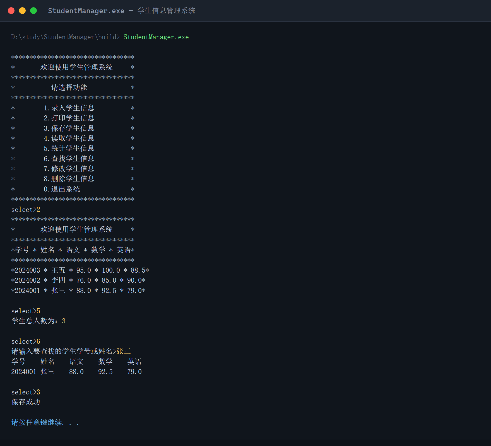

# 学生信息管理系统（StudentManager）

一个用 C 语言写的**控制台学生信息管理系统**，用单链表存放学生数据，支持录入、打印、查找、修改、删除、统计，以及把数据保存到文件、下次启动时读回来。

写完这个项目的目的是把 C 语言里最核心的几块串起来练一遍：结构体、指针、单链表、枚举 + 菜单、文件读写。



## 功能

| 序号 | 功能 | 说明 |
| --- | --- | --- |
| 1 | 录入学生信息 | 头插法把学生插到链表头，O(1) 完成 |
| 2 | 打印学生信息 | 遍历链表，按表格输出全部学生 |
| 3 | 保存学生信息 | 存成文本文件 `student.txt`，记事本能直接打开 |
| 4 | 读取学生信息 | 从 `student.txt` 把数据读回链表 |
| 5 | 统计学生信息 | 遍历计数，顺便验证 `list->size` 是否准确 |
| 6 | 查找学生信息 | 学号或姓名都能查 |
| 7 | 修改学生信息 | 按学号 / 姓名定位后修改三科成绩 |
| 8 | 删除学生信息 | 处理首节点与非首节点两种情况，释放内存 |
| 0 | 退出系统 | 退出前自动保存一次，避免录入的数据丢失 |

学生信息包括：学号（64 位无符号整型）、姓名（最长 31 字节）、语文 / 数学 / 英语三科成绩（`float`）。

## 项目结构

```
StudentManager/
├── include/
│   └── student_manager.h     # 结构体、枚举声明与接口声明
├── src/
│   ├── main.c                # 程序入口：菜单循环 + switch 分发
│   └── student_manager.c     # 各功能的具体实现
├── docs/
│   └── demo.png              # 运行效果截图
├── CMakeLists.txt            # CMake 构建脚本（跨平台）
├── StudentManager.sln        # Visual Studio 解决方案
├── StudentManager.vcxproj
├── LICENSE
└── README.md
```

## 编译运行

### 方式一：Visual Studio（Windows，最省事）

1. 双击 `StudentManager.sln` 用 VS 2022 打开；
2. 顶部选 `Release` + `x64`；
3. 按 `Ctrl + F5` 编译运行。

### 方式二：命令行（VS 开发者命令提示）

```bat
cl /W3 /I include src\main.c src\student_manager.c /Fe:StudentManager.exe
```

### 方式三：CMake（Windows / Linux / macOS 通用）

```bash
cmake -B build
cmake --build build --config Release
./build/StudentManager      # Windows 上是 build\Release\StudentManager.exe
```

> 源码文件保存为 **UTF-8（含 BOM）**，MSVC 会按系统编码正确输出中文。若用 MinGW / gcc 编译后控制台出现乱码，先执行 `chcp 65001` 再运行。

## 数据文件格式

程序保存时会在**当前工作目录**生成 `student.txt`，一行一名学生，字段之间用空白分隔：

```
2024001 张三 88.0  92.5  79.0
2024002 李四 76.0  85.0  90.0
2024003 王五 95.0  100.0 88.5
```

也就是说这个文件可以手动用记事本修改，再在程序里选「4. 读取学生信息」读回来。

另外 `student_manager.c` 里还提供了二进制版本的 `saveStudent` / `readStudent`（对应 `students.data`），结构体整块写入磁盘，体积更小、读写更快，适合数据量大的场景，默认的菜单流程用的是文本版本。

## 实现要点

- **链表表头单独抽出来**：`List` 只保存 `front` 指针和 `size`，不存放数据，所有接口都通过 `List*` 操作，增删时不用改指针本身。
- **头插法录入**：新节点直接接到 `front` 上，插入 O(1)；代价是打印顺序与录入顺序相反。
- **删除要记前驱**：遍历时用 `prevNode` 记住上一个节点，删除首节点和中间节点走不同分支，删完 `free` 掉并让 `size--`。
- **枚举当菜单索引**：`MenuOptions` 的取值顺序（`Quit = 0, Entry = 1 …`）与 `menu()` 返回的序号完全对应，`switch` 里直接用枚举名，可读性比裸数字好。
- **查找同时支持学号和姓名**：先把输入当数字解析一次，解析成功按学号比、失败则按姓名比，一个输入框搞定两种查法。
- **两套存储格式**：文本版方便人看和改，二进制版方便机器批量读写，读函数用 `fscanf` / `fread` 的返回值判断是否读完，避免多读一条脏数据。

## 已知不足 / 可改进方向

- 数据全在内存，退出才落盘，程序崩溃会丢数据；
- 学号重复没有校验；
- 链表只支持头插，打印顺序是倒序，可以改成尾插或按学号排序后输出；
- 目前不支持按科目排序、班级分组、平均分/排名统计；
- 没有单元测试，后续可以给链表操作补上。

## License

[MIT](LICENSE)
